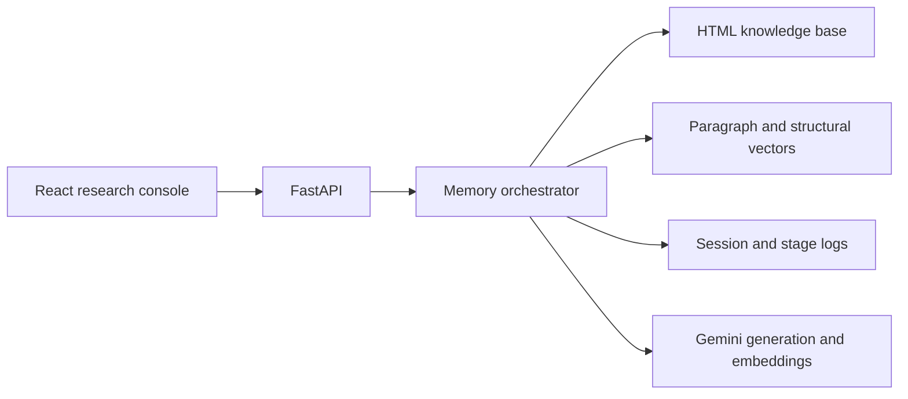

# EngramTrace

**Structured long-term memory for conversational language models.**

EngramTrace is a research prototype that stores conversational knowledge in an editable HTML tree. It retrieves relevant paragraphs with their surrounding structure and consolidates conversations into that tree when the topic changes, without updating model weights.

**[Read the final technical report →](engramtrace_technical_report.md)**

The report explains the research question, architecture, memory lifecycle, implementation, verification, and limitations. It can be read on GitHub without installing or running the project.

## Project at a glance

- **Inspectable memory:** an HTML knowledge base with stable content-derived IDs, an editor, and an interactive DOM graph.
- **Context-aware retrieval:** paragraph embeddings blended with structural ancestors, supplemented by keyword search.
- **Incremental consolidation:** topic drift or a 15-turn buffer triggers a merge into persistent memory.
- **Session continuity:** separate conversation logs share a common knowledge base.

This repository contains the implementation and report. It does **not** include validated benchmark scores or establish an accuracy advantage over other memory systems. The application is a local research console with a shared engine and no authentication.



## Run locally

Use **Python 3.13** and **Node.js 22.12+**. Live inference requires a Google API key with access to the configured Gemini models and may incur API charges. Reading the report and running the mock tests require no key.

From the repository root:

```bash
python3.13 -m venv .venv
source .venv/bin/activate
pip install -r backend/requirements.txt
python -m nltk.downloader stopwords punkt_tab wordnet
cp backend/.env.example backend/.env
# Set GOOGLE_API_KEY in backend/.env, then:
cd backend
python main.py
```

In a second terminal, from the repository root:

```bash
cd frontend
npm ci
npm run dev
```

Open the URL printed by Vite (normally `http://127.0.0.1:5173`). The dev server proxies API calls to `http://127.0.0.1:8000`; API documentation is at `http://127.0.0.1:8000/docs`. Start the backend from `backend/` so its relative storage paths resolve correctly.

### Explore the prototype

1. Start a conversation in the chat console.
2. Change topics to trigger consolidation, or use **Force Day Change** to consolidate and reorganize memory manually.
3. Open **KB Studio** to inspect the HTML source or DOM graph. Saving an edit rebuilds its embeddings.
4. Inspect the stage/session logs and trace set to follow the memory lifecycle.

The default generation model is `gemini-3.1-flash-lite-preview`; embeddings use `gemini-embedding-001` at 256 dimensions. Override `GEMINI_MODEL` and `GEMINI_EMBEDDING_MODEL` in `backend/.env` if needed. Model availability depends on your account. Rebuild memory embeddings when changing the embedding model.

Conversations, knowledge, vectors, and stage archives are generated under `backend/src/memory/` and excluded from Git, along with credentials and local build output. Back up this directory before using the memory wipe controls.

## Verification

From the repository root with the Python environment active:

```bash
pip install -r backend/requirements-dev.txt
python -m pytest backend/tests -q
```

From `frontend/`:

```bash
npm run lint
npm run build
```

The tests use deterministic mock models and temporary directories. They check memory storage, retrieval, consolidation, session separation, and inference controls without contacting Gemini. GitHub Actions runs these checks on pushes and pull requests. Live model quality and benchmark accuracy remain unvalidated.

## Source map

| Path | Purpose |
| --- | --- |
| [Technical report](engramtrace_technical_report.md) | Design, implementation, evidence, and limitations |
| [backend/src/core/brain.py](backend/src/core/brain.py) | Conversation orchestration, drift detection, and consolidation |
| [backend/src/core/memory.py](backend/src/core/memory.py) | HTML storage, embeddings, and retrieval |
| [backend/src/llm/langchain_client.py](backend/src/llm/langchain_client.py) | Gemini adapter and generation prompts |
| [backend/api/routes](backend/api/routes) | Chat, memory, state, and session endpoints |
| [backend/tests](backend/tests) | Isolated regression tests |
| [frontend/src](frontend/src) | Chat console, KB editor, DOM graph, and inspector |
