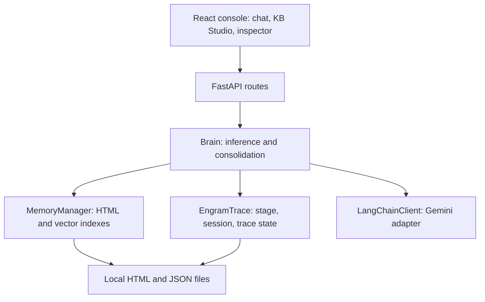

# EngramTrace: Structured Long-Term Memory for Conversational Language Models

**Final technical report**

**Original design:** April 19, 2026 · **Publication revision:** October 25, 2026

**[Repository](https://github.com/iamtaehyunpark/EngramTrace)** · **[Project overview and setup](README.md)**

## Abstract

EngramTrace explores a question: can an explicit, editable document hierarchy serve as persistent memory for a conversational language model? The prototype stores knowledge in an HTML document, indexes paragraphs with embeddings informed by their structural ancestors, and retrieves surrounding HTML fragments for response generation. Conversations first enter a short-term stage buffer. Topic drift or a buffer limit triggers consolidation into the persistent document. A separate reorganization pass can deduplicate and restructure the knowledge base.

The contribution is an inspectable implementation of this memory lifecycle, including a chat console, HTML editor, graph visualization, and session logs. Deterministic tests exercise the core storage and orchestration paths. No validated benchmark results are included, so this report describes the system's mechanisms and engineering tradeoffs without claiming improved answer accuracy or biological fidelity.

## Contents

1. [Research question and scope](#1-research-question-and-scope)
2. [System architecture](#2-system-architecture)
3. [Memory representation](#3-memory-representation)
4. [Retrieval and conversation flow](#4-retrieval-and-conversation-flow)
5. [Consolidation and reorganization](#5-consolidation-and-reorganization)
6. [Research interface and persistence](#6-research-interface-and-persistence)
7. [Verification and evaluation status](#7-verification-and-evaluation-status)
8. [Limitations and future work](#8-limitations-and-future-work)
9. [Reproduction and source guide](#9-reproduction-and-source-guide)

## 1. Research question and scope

A conversational model's context window does not itself provide a durable, editable record of earlier interactions. EngramTrace separates that record from model weights and makes it available through retrieval.

The design tests three implementation ideas:

- **Structure as context:** a paragraph's enclosing section can provide useful meaning beyond the paragraph alone.
- **Conversation as a staging area:** a short sequence of related exchanges can be merged into persistent knowledge when a topic ends.
- **Memory as an inspectable artifact:** users can read, edit, and visualize what the system stores.

Encoding, retrieval, and reconsolidation provide a neuroscience-inspired vocabulary for the pipeline. These are design analogies rather than claims that the system reproduces human memory.

The scope is a local, single-engine research prototype. Named sessions have separate conversation logs and ephemeral trace state, while all sessions share one knowledge base. The system augments an external Gemini model; it does not train or fine-tune model weights.

## 2. System architecture



The backend separates three responsibilities:

| Component | Responsibility | Source |
| --- | --- | --- |
| `Brain` | Runs inference, checks drift, invokes retrieval, and merges stage knowledge | [brain.py](backend/src/core/brain.py) |
| `EngramTrace` | Manages active sessions, stage/session logs, retrieved IDs, and recent Q-A vectors | [brain.py](backend/src/core/brain.py) |
| `MemoryManager` | Parses and mutates HTML, assigns IDs, maintains embeddings, and searches memory | [memory.py](backend/src/core/memory.py) |
| `LangChainClient` | Generates answers and HTML, synthesizes stage logs, and requests embeddings | [langchain_client.py](backend/src/llm/langchain_client.py) |

FastAPI exposes these through chat, state, memory, trace, and session routes. The frontend uses React 19 and Vite 8, with CodeMirror for editing and React Flow plus dagre for graph layout. BeautifulSoup with lxml handles HTML parsing; NumPy handles vector math; NLTK supplies keyword processing.

The default generation model is configured as `gemini-3.1-flash-lite-preview` with temperature 0.1. The default embedding model is `gemini-embedding-001`, requesting 256-dimensional vectors. Both identifiers can be overridden through environment variables. These are implementation settings, not model availability guarantees.

## 3. Memory representation

### HTML knowledge tree

The persistent knowledge base is an HTML document. Sections express conceptual grouping, headings label topics, and `<p>` elements act as the atomic retrieval units. A simplified example is:

```html
<main id="root">
  <section id="section-example">
    <h2>Research preferences</h2>
    <p id="p-example">The user prefers interpretable memory systems.</p>
  </section>
</main>
```

Generation prompts request nested sections and one coherent concept per paragraph. This matters because content stored only in a list or table is not independently indexed as a paragraph, although it can appear in retrieved parent context.

For supported nonempty tags without an ID, the engine derives an ID from the tag name and the first 12 hexadecimal characters of a SHA-256 hash of its text. Existing IDs are preserved. This is deterministic content addressing, with limitations: duplicate text can create duplicate IDs, and edits that preserve an existing ID can leave cached embeddings stale.

### Hierarchical embedding blending

During atomization or an editor-triggered rebuild, the engine embeds active paragraphs and eligible structural ancestors. It combines vectors from the top of each lineage downward:

```text
v(root) = e(root)
v(node) = 0.7 × e(node) + 0.3 × v(parent)
```

Here `e(node)` is the raw embedding and `v(node)` is the blended vector. If no usable parent vector exists, the raw embedding is used. Eligible structural tags are `body`, `main`, `section`, `article`, and `div`; an ancestor must have an ID to participate in the cached mapping.

The intended effect is to retain a paragraph's local meaning while adding a decaying contribution from its ancestors. For example, the same sentence under different topics can receive different indexed vectors. Whether that improves retrieval requires an ablation study; it is not demonstrated by this release.

Paragraph entries store a CSS selector, vector, and consolidation timestamp. A separate structural cache supports incremental updates. Full rebuilds regenerate hierarchical vectors; stage consolidation embeds new paragraph IDs using cached ancestry and prunes removed paragraph IDs. It does not rebuild every structural vector after every merge.

## 4. Retrieval and conversation flow

```mermaid
sequenceDiagram
    participant User
    participant Brain
    participant Trace as Stage manager
    participant Memory
    participant Model as Gemini adapter
    User->>Brain: Query
    Brain->>Model: Embed query
    Brain->>Trace: Compare with recent Q-A vectors
    opt Topic drift or stage capacity reached
        Brain->>Brain: Consolidate and transition
    end
    Brain->>Memory: Semantic search; keyword search at stage start
    Memory-->>Brain: Matching paragraph IDs
    Brain->>Trace: Accumulate trace and collect parent HTML
    Brain->>Model: Generate answer with retrieved and recent context
    Brain->>Model: Embed Q-A pair
    Brain->>Trace: Persist logs and update recent vectors
    Brain-->>User: Answer
```

### Topic drift and query continuity

The stage manager compares the new query embedding with the mean of up to three recent Q-A embeddings using cosine similarity. A score below the configured stage threshold indicates drift. The default threshold is 0.83; this is a chosen parameter rather than a benchmark-tuned optimum.

For a continuing stage, retrieval blends 70% of the current query vector with 30% of the most recent Q-A vector. A new stage uses the raw query vector. The orchestration re-reads the stage after a transition so query blending and stage-start keyword search see the cleared buffer.

### Dual retrieval

Semantic search computes cosine similarity against stored paragraph vectors. Entries above the search threshold, default 0.80, are returned. If none pass, the engine falls back to the three highest-scoring entries, or fewer if the knowledge base is smaller. This avoids an empty result set but can introduce irrelevant context.

At stage start, keyword search supplements semantic retrieval using NLTK tokenization, stop-word removal, query lemmatization, and a minimum token length of three characters. It scores keyword substrings in paragraphs and list items that already have IDs; list items do not receive automatic IDs. Retrieved IDs accumulate in the active trace. For generation, the engine collects the enclosing HTML parents of traced nodes rather than passing only individual sentences. Identical parent fragments are deduplicated; nested or overlapping parents can still introduce redundant context.

### Generation and inference controls

The answer prompt includes retrieved long-term context and the current stage history. Up to four recent session entries are replayed as message pairs. The model is also allowed to answer from its general knowledge, so a plausible answer is not evidence that memory retrieval succeeded.

After generation, the full Q-A pair is embedded and added to the recent vector stack. It is written to the stage log and session log, with these optional controls:

| Control | Behavior |
| --- | --- |
| `no_search` | Skips both retrievers and uses the existing trace |
| `no_memorize` | Skips stage-log insertion; session logging and Q-A vector updates still occur |

`no_memorize` is therefore not a complete read-only mode. An evaluation harness would need to isolate additional state to prevent query contamination.

## 5. Consolidation and reorganization

### Stage consolidation

A stage is consolidated when drift is detected or when the buffer already contains at least 15 Q-A pairs before processing the next query. The engine:

1. Collects the stage log and relevant HTML parent fragments.
2. Asks the model to synthesize updated or new HTML fragments.
3. Replaces fragments carrying a matching ID or appends new fragments.
4. Assigns missing IDs, persists HTML, updates paragraph embeddings, and prunes deleted IDs.
5. Archives the completed stage and starts a new one.

A special case unwraps a returned `main#root` container to reduce the risk of replacing the entire knowledge base. This is a narrow guard, not a general guarantee against destructive or inaccurate model output. The system has no transactional rollback or factual verification of a merge.

### Reorganization after inactivity

The automatic “day change” branch is reached when topic drift is detected and the last stage interaction was more than 4,000 seconds earlier. It is not an independent scheduled timer. Pending stage knowledge is consolidated, then the model reorganizes and deduplicates the knowledge base, followed by a hierarchical embedding rebuild.

The UI also exposes a manual **Force Day Change** action. The prompt asks the model to preserve substantive content and prioritize recent information when resolving conflicts. Preservation remains dependent on model output.

## 6. Research interface and persistence

The interface makes internal memory state visible:

- **Chat console:** conversation rendering, inference controls, drift/search thresholds, and polled server logs.
- **KB Studio:** HTML source editing, preview, save with embedding rebuild, and a graph of the document hierarchy.
- **DOM graph:** tag-based node colors, expandable text, retrieved-node highlighting, and trace membership toggles.
- **Data inspector:** current trace, stage log, and session log.
- **Session sidebar:** create, select, and delete named sessions.

The backend creates the following files under `backend/src/memory/` at runtime:

| Artifact | Purpose |
| --- | --- |
| `knowledge_base.html` | Shared long-term knowledge document |
| `p_embeddings.json` | Paragraph selectors, vectors, and timestamps |
| `structural_embeddings.json` | Cached ancestor vectors |
| `sessions/{id}.json` | Conversation history; latest entry can carry `last_qa_vec` |
| `sessions/{id}_stage.json` | Unconsolidated conversation buffer |
| `stage_history/*.json` | Archived completed stages |

Trace sets and recent vector stacks are held in memory per session. Startup attempts to reconstruct recent vectors for the default session from its saved stage. Switching sessions does not provide complete restart recovery for every session's ephemeral state.

Runtime data and credentials are excluded from version control. A fresh checkout begins with an empty knowledge base; it contains no sample personal conversations or precomputed memory.

## 7. Verification and evaluation status

The repository includes deterministic tests using mock generation and embedding clients. Each test writes to temporary storage. Coverage includes:

| Area | Evidence checked |
| --- | --- |
| Atomization and persistence | Stable ID assignment and persisted embedding schema |
| Index maintenance | Deleted paragraphs are pruned; wiping resets memory and removes indexes |
| Retrieval | Top-match fallback works when no similarity clears the threshold |
| Conversation lifecycle | Topic drift consolidates the prior stage and starts a new buffer |
| Transition regression | Keyword retrieval runs against the new stage after consolidation |
| Inference controls | Search can be bypassed; `no_memorize` retains only session logging |
| Session separation | Named sessions retain independent conversation logs |
| API smoke test | State, sessions, chat, manual reorganization, and OpenAPI respond with mock models |

Publication checks passed locally: **10 backend tests**, frontend lint, and frontend production compilation. Live inference was not exercised.

GitHub Actions installs the backend dependencies and NLTK corpora, runs the tests, and checks frontend lint and production compilation. These checks validate selected implementation behavior. They do not measure retrieval relevance, answer correctness, live API compatibility, or long-horizon memory retention.

**No validated benchmark accuracy, latency, cost, or baseline comparison is included in this release.** Earlier documentation referred to a separate LongMemEval harness and invalid evaluation output. That harness, dataset, and result artifacts are not present here, so those references cannot serve as reproducible evidence and no performance claim is made from them.

A future evaluation should publish the harness, dataset version, model configuration, prompts, state-reset protocol, raw outputs, and scoring method. Useful comparisons would isolate flat versus hierarchical embeddings, keyword supplementation, and consolidation, while measuring answer accuracy, retrieval relevance, token usage, API calls, and merge-related information loss.

## 8. Limitations and future work

The main limits are structural and operational:

- **Single shared engine:** global state and file writes lack concurrency control. Session switching affects the active backend session. Multiple workers or simultaneous users can produce inconsistent state.
- **Local research scope:** no authentication, user isolation, or deployment hardening is implemented. The console should remain local.
- **Model-dependent memory quality:** hallucinations, malformed fragments, and lossy merges can enter persistent memory. Stored model answers may later be retrieved as if they were facts.
- **Cache consistency:** incremental consolidation can reuse stale structural vectors. Existing paragraph IDs can also retain vectors after their text changes. A full rebuild is needed to restore consistency.
- **ID ambiguity:** identical text can produce duplicate content-derived IDs, weakening node-level selection and replacement.
- **Unbounded storage and context:** session files, captured logs, and trace sets can grow. Parent-fragment retrieval can consume more context than the matched paragraphs alone.
- **Synchronous external calls:** model operations block request handling, responses are not streamed, and retry/error behavior is limited.
- **Document-scale cost:** the full knowledge base is parsed in memory, and reorganization rebuilds its hierarchy and vectors. No scale or cost envelope has been established.
- **Prompt-dependent hierarchy:** no deterministic heading-to-section normalization is applied. The active path relies on generated nesting.
- **Incomplete evidence:** mock tests cannot establish live model quality or a benefit over simpler retrieval systems.

The most useful next steps are a reproducible evaluation harness, transactional storage with rollback, robust ID and cache invalidation rules, and explicit concurrency/session isolation. Larger-scale storage, streaming, and alternative model providers should follow evidence about the core memory design.

## 9. Reproduction and source guide

Use the [README setup instructions](README.md#run-locally) for Python 3.13, Node.js 22.12+, NLTK corpora, environment variables, and the two local servers. The Python runtime dependencies and frontend dependency tree are recorded in [requirements.txt](backend/requirements.txt) and [package-lock.json](frontend/package-lock.json). Run the backend from `backend/` because storage paths are relative to the working directory.

For implementation review, start with:

1. [Brain and stage manager](backend/src/core/brain.py): `run_inference`, `consolidate_and_transition`, `_calculate_stage_drift`, and `BufferQAPair`.
2. [Memory manager](backend/src/core/memory.py): `atomizer`, `_finalize_and_sync`, `sync_embeddings_hierarchical`, `sync_embeddings`, and the retrieval methods.
3. [Model adapter](backend/src/llm/langchain_client.py): generation prompts and embedding configuration.
4. [API routes](backend/api/routes) and [frontend components](frontend/src): the research console's controls and state inspection.
5. [Regression tests](backend/tests): executable examples of the verified behaviors.

This report documents an implemented memory architecture and its current verification boundary. Establishing its effectiveness remains an empirical research task.
